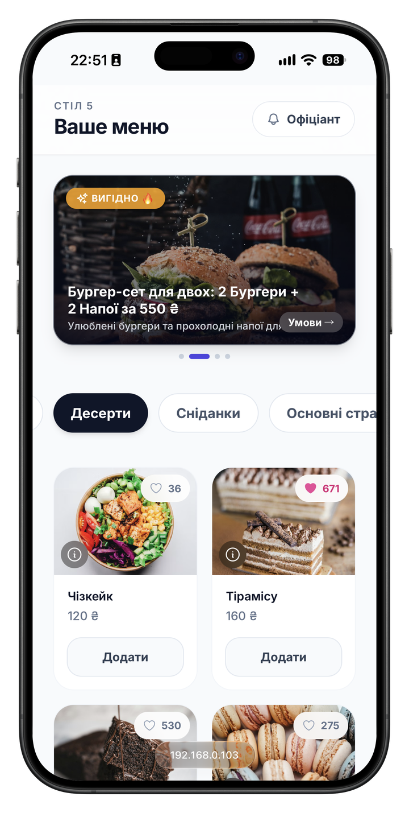
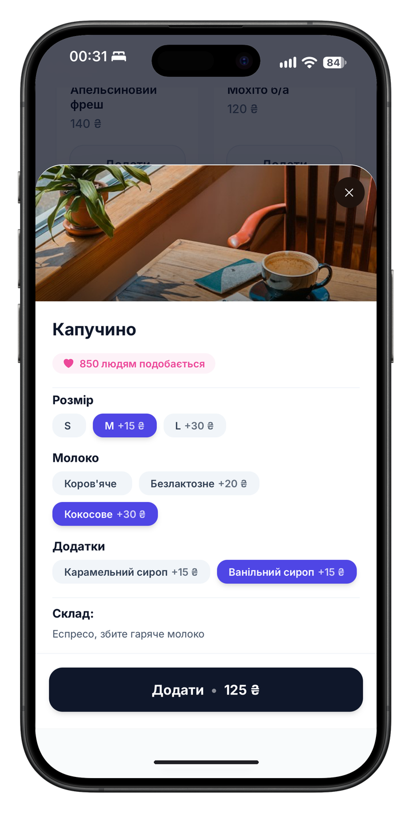
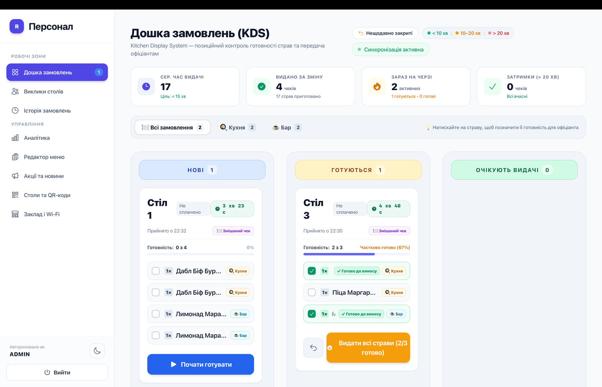
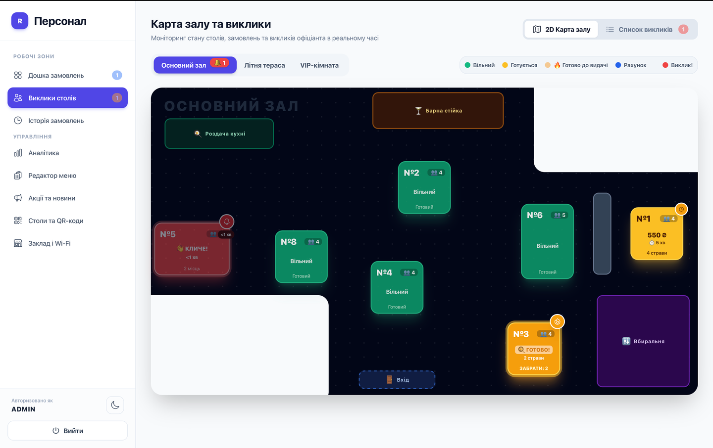
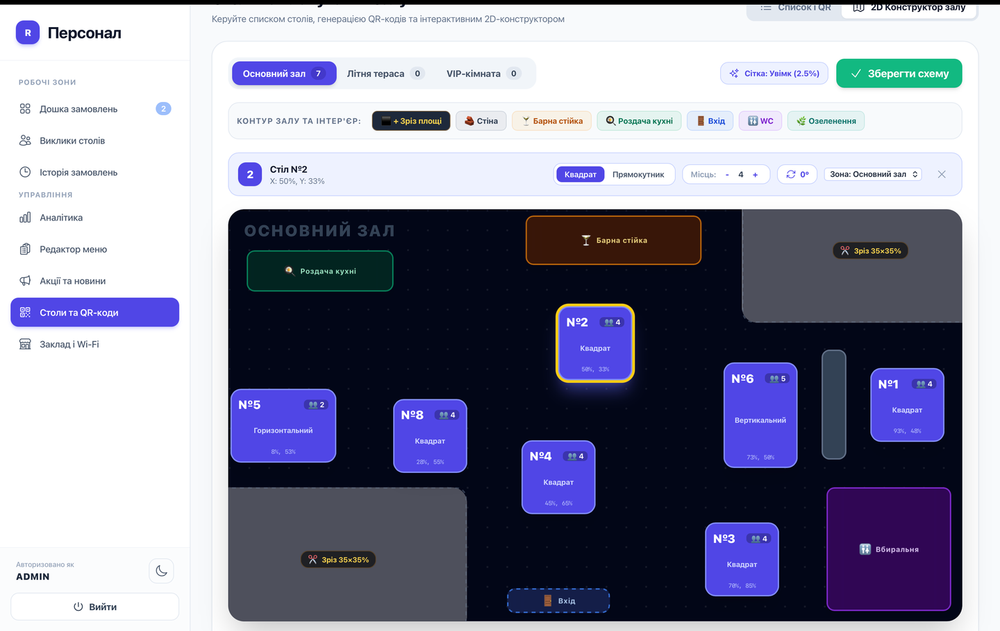
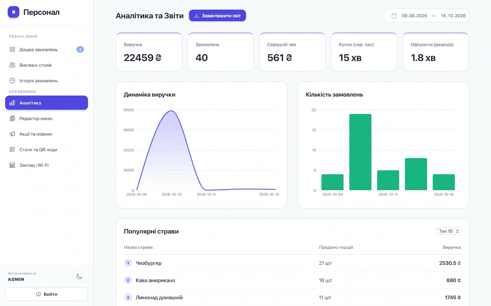
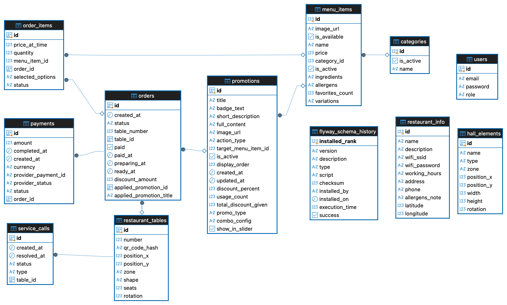

# Restaurant QR Ordering & KDS Platform

Повнофункціональний MVP-сервіс автоматизації ресторану (аналог ChoiceQR): безконтактне QR-меню для гостей, real-time Kitchen Display System (KDS) для кухні, інтерактивна 2D-карта залу для офіціантів, конструктор плану приміщення, промо-акції, онлайн-оплата через LiqPay та операційна аналітика.

---

## Технологічний стек

| Шар | Технології |
| --- | --- |
| **Backend** | Java 21, Spring Boot 4.1, Spring Security (Stateless JWT + `@PreAuthorize`), Spring Data JPA (Hibernate), Spring WebSocket (STOMP), Flyway, Caffeine Cache, ZXing, Springdoc OpenAPI (Swagger UI), LiqPay API v3 |
| **Database** | PostgreSQL 16 (`spring.jpa.open-in-view=false`, `ddl-auto=validate`, 15 Flyway-міграцій, індекси продуктивності у `V15`) |
| **Frontend** | React 19, TypeScript, Vite, Tailwind CSS, `@stomp/stompjs`, Recharts, Leaflet |
| **Infrastructure** | Docker, Docker Compose, Nginx (роздача SPA та reverse proxy для `/api/`, `/ws/`, `/uploads/`) |

---

## Основні можливості за ролями

- **Гість (`ROLE_GUEST`)**:
  - Авторизація за QR-кодом столу (`/?qr=<hash>`) із видачею 4-годинного JWT-токена, прив'язаного до конкретного `tableId`.
  - Перегляд меню за категоріями, пошук, інформація про склад та алергени, вподобання позицій, модальне вікно вибору варіацій/модифікаторів із динамічним перерахунком ціни.
  - Інтерактивний промо-слайдер та застосування акційних/комбо-знижок до замовлення.
  - Відстеження статусів кожної страви у реальному часі, онлайн-оплата через LiqPay (+ ручна синхронізація статусу платежу), виклик офіціанта або паперового рахунку, карта закладу (Leaflet) і дані Wi-Fi.
- **Кухня (`ROLE_COOK`, `/staff/kitchen`)**:
  - Real-time Kanban-дошка KDS із гранулярним життєвим циклом кожної позиції замовлення (`NEW` → `PREPARING` → `READY` → `SERVED`).
  - Фільтрація за цехами, таймери приготування, метрики швидкості видачі (KDS metrics), перегляд історії та повернення закритих замовлень (`recall`).
- **Офіціант (`ROLE_WAITER`, `/staff/waiter`)**:
  - Інтерактивна 2D-карта залу з відображенням зайнятості столів, бейджами готових до видачі страв та миттєвими сповіщеннями про сервісні виклики.
- **Адміністратор (`ROLE_ADMIN`, `/staff/*`)**:
  - Інтерактивний 2D-конструктор залу (зони, форма/розміщення/поворот столів, бар, роздача кухні, вхід, санвузол тощо).
  - Керування столами й завантаження згенерованих ZXing QR-кодів у PNG, редактор категорій/страв і фото, конструктор акцій та комбо-правил, аналітика виручки/середнього чека/швидкості обслуговування, налаштування закладу й Wi-Fi.

---

## Скріншоти інтерфейсу

### Гостьовий мобільний застосунок

<table>
  <tr>
    <td align="center" width="50%">
      
      <br />
      <sub>Головний екран QR-меню: прив'язка до столу, промо-слайдер, категорії та вподобання</sub>
    </td>
    <td align="center" width="50%">
      
      <br />
      <sub>Вибір варіацій і додатків із динамічним перерахунком вартості</sub>
    </td>
  </tr>
</table>

### Панель персоналу та адміністратора

<table>
  <tr>
    <td align="center" width="50%">
      
      <br />
      <sub>Кухонна дошка (KDS): Kanban-черги, статуси окремих позицій та оперативні метрики</sub>
    </td>
    <td align="center" width="50%">
      
      <br />
      <sub>Панель офіціанта: 2D-карта залу в реальному часі з викликами столів і готовністю страв</sub>
    </td>
  </tr>
  <tr>
    <td align="center" width="50%">
      
      <br />
      <sub>Інтерактивний 2D-конструктор плану залу, зон і розташування столів</sub>
    </td>
    <td align="center" width="50%">
      
      <br />
      <sub>Аналітика закладу: виручка, кількість замовлень, швидкість кухні/офіціантів та топ страв</sub>
    </td>
  </tr>
</table>

---

## Архітектура та інженерні рішення

```mermaid
flowchart LR
    Guest["Гість: QR SPA"] -->|"HTTPS / REST + STOMP"| Nginx["Nginx Reverse Proxy"]
    Staff["Персонал: KDS / Карта / Адмін"] -->|"HTTPS / REST + STOMP"| Nginx

    Nginx -->|"/api/*, /ws/*, /uploads/*"| API["Spring Boot 4.1 Backend"]

    subgraph API_Core["Backend Layers (Java 21)"]
        Security["Stateless JWT Filter + STOMP Interceptor"]
        Services["Domain Services + ApplicationEventPublisher"]
        Cache["Caffeine Cache (menuItems, categories, restaurantInfo)"]
        Events["TransactionalEventListener (AFTER_COMMIT) -> STOMP Broker"]
    end

    API --> API_Core
    API_Core -->|"JPA / Flyway (V1-V15)"| PG[("PostgreSQL 16")]
    API_Core -->|"Checkout + SHA-1 Webhook + Status Sync"| LiqPay["LiqPay API v3"]
```



Ключові бекенд-рішення у проєкті:

- **Узгодженість WebSocket-подій із транзакціями БД**: `OrderEventListener` та `ServiceCallEventListener` використовують `@TransactionalEventListener(phase = TransactionPhase.AFTER_COMMIT)`. Події розсилаються підписникам STOMP лише після успішного коміту транзакції, що виключає фантомні сповіщення у разі rollback.
- **Подвійна stateless JWT-автентифікація (HTTP + WebSocket)**:
  - Персонал (`ROLE_ADMIN`, `ROLE_COOK`, `ROLE_WAITER`) отримує токен на 24 години, гість (`ROLE_GUEST`) — 4-годинний токен із `GuestPrincipal`, прив'язаним до `tableId`.
  - Авторизація перевіряється як у HTTP-фільтрі (`JwtAuthenticationFilter` + `@PreAuthorize`), так і під час `STOMP CONNECT` / `SUBSCRIBE` у `StompAuthChannelInterceptor`.
  - Гості підписуються на ізольовані персональні черги (`/user/queue/order-updates`, `/user/queue/service-calls`), персонал — на широкомовні канали (`/topic/kitchen`, `/topic/service-calls`), а клієнтський `STOMP SEND` заблоковано (мутації йдуть виключно через REST).
- **Надійність даних та продуктивність**:
  - `spring.jpa.open-in-view=false` гарантує виконання всіх запитів до БД у межах сервісних транзакцій без прихованих N+1 під час серіалізації DTO.
  - Схема БД керується виключно через Flyway (`V1`–`V15`) з `hibernate.ddl-auto=validate`.
  - Локальний кеш `Caffeine` (`menuItems`, `categories`, `restaurantInfo`) із TTL 60 хв, записом метрик (`recordStats()`) та скиданням кешу при мутаціях.
- **Стійка інтеграція LiqPay v3 без стороннього SDK**: мінімальний клієнт `LiqPayClient` формує `base64(json)` + `SHA-1` підпис, перевіряє вхідні webhook-колбеки (`POST /api/v1/payments/liqpay/callback`) за сталий час (`MessageDigest.isEqual`) і підтримує синхронний fallback-запит статусу (`POST /api/v1/payments/{id}/sync`) для середовищ без публічного callback-URL.

---

## Схема бази даних (ERD)

<picture>
  <source media="(prefers-color-scheme: dark)" srcset="docs/images/db-schema-dark.png" />
  <source media="(prefers-color-scheme: light)" srcset="docs/images/db-schema-light.png" />
  
</picture>

---

## Огляд REST API та WebSocket

Повна інтерактивна специфікація доступна після запуску бекенду в Swagger UI: `http://localhost:8080/swagger-ui.html`.

| Група ендпоінтів | Базовий шлях | Призначення |
| --- | --- | --- |
| **Auth** | `/api/v1/auth` | Вхід персоналу (`/staff-login`) та гостьовий вхід за QR-хешем (`/table-login`) |
| **Menu** | `/api/v1/menu` | Категорії, страви, варіації, вподобання (`like`), доступність, завантаження зображень |
| **Orders & KDS** | `/api/v1/orders` | Створення замовлення гостем, черги `/active`, гранулярні статуси позицій, `/kds-metrics`, `/history`, `/recent-closed`, `/recall`, застосування акцій |
| **Payments** | `/api/v1/payments` | Ініціація оплати (`/checkout`), ручна перевірка статусу (`/{id}/sync`), webhook (`/liqpay/callback`) |
| **Service Calls** | `/api/v1/service-calls` | Виклик офіціанта/рахунку гостем, моніторинг активних викликів і закриття (`/{id}/resolve`) |
| **Tables & QR** | `/api/v1/tables` | Керування столами, позиціями на 2D-плані, регенерація QR-хешу та експорт PNG (`/{id}/qr.png`) |
| **Hall Elements** | `/api/v1/hall-elements` | Елементи інтер'єру та зони для інтерактивного 2D-конструктора залу |
| **Promotions** | `/api/v1/promotions` | Активні промо для гостей, CRUD акцій і комбо-правил, керування слайдером |
| **Analytics** | `/api/v1/admin/analytics` | Виручка, кількість чеків, середній чек, час приготування/реакції, топ страв |
| **Restaurant Info** | `/api/v1/restaurant-info` | Контакти, графік роботи, Wi-Fi, примітка про алергени, координати на карті |

**WebSocket / STOMP** (endpoint: `/ws/orders`):
- `/topic/kitchen` — події замовлень для кухні, офіціантів та адміністратора;
- `/topic/service-calls` — виклики столів для офіціантів та адміністратора;
- `/user/queue/order-updates` та `/user/queue/service-calls` — ізольовані персональні оновлення для конкретного столу.

---

## Швидкий старт

### Варіант 1: Docker Compose (весь стек)

```bash
# 1. Скопіюйте приклад змінних оточення (за потреби додайте sandbox-ключі LiqPay)
cp .env.docker.example .env

# 2. Зберіть та запустіть PostgreSQL, Spring Boot backend і React/Nginx frontend
docker compose up --build -d
```

Після запуску сервіси доступні за адресами:
- **Фронтенд (гість і персонал)**: `http://localhost:5173` (сторінка входу персоналу: `http://localhost:5173/login`)
- **Swagger UI**: `http://localhost:8080/swagger-ui.html`

> **Демо-акаунти персоналу** (автоматично створюються при першому старті через `DataInitializer`, якщо таблиця `users` порожня):
> - Адміністратор: `admin@restaurant.com` / `admin123`
> - Кухар: `cook@restaurant.com` / `cook123`
> - Офіціант: `waiter@restaurant.com` / `waiter123`

### Варіант 2: Локальний запуск для розробки

1. Запустіть PostgreSQL (за замовчуванням `application.yaml` очікує `jdbc:postgresql://localhost:54321/restaurant_db`, наприклад через `docker compose up -d db`).
2. Запустіть бекенд:
   ```bash
   ./mvnw spring-boot:run
   ```
3. Запустіть фронтенд (Vite автоматично проксіює `/api/*` та `/ws/*` на `http://localhost:8080`):
   ```bash
   cd frontend
   npm install
   npm run dev
   ```

### Запуск тестів

Набір тестів включає контекстні тести, наскрізні WebSocket/REST інтеграційні тести (`OrderWebSocketIT`, `AdditionalFeaturesIT` поверх `IntegrationTestSupport`) та бенчмарк кешування (`CachePerformanceTest`). Для виконання інтеграційних тестів має бути запущена база даних PostgreSQL (`localhost:54321/restaurant_db`):

```bash
./mvnw test
```

---

## Структура проєкту

```text
.
├── docs/images/                # Скріншоти UI та світла/темна ERD-схеми БД
├── frontend/                   # React 19 + TypeScript + Vite + Tailwind + Nginx
│   ├── src/
│   │   ├── GuestApp.tsx        # Мобільний інтерфейс гостя
│   │   ├── StaffApp.tsx        # Оболонка кабінету персоналу та навігація за ролями
│   │   ├── pages/              # KitchenBoard (KDS), WaiterBoard, Admin* сторінки
│   │   ├── components/         # PromoCarousel, LeafletMap
│   │   ├── api.ts              # Axios-клієнт з інтерцепторами JWT
│   │   └── ws.ts               # STOMP WebSocket-клієнт
│   ├── Dockerfile
│   └── nginx.conf
├── src/main/java/com/vlad/restaurant/
│   ├── config/                 # Security, Cache, Web, OpenAPI, DataInitializer
│   ├── controller/             # REST-контролери (/api/v1/*)
│   ├── dto/                    # Request/Response та WebSocket-повідомлення
│   ├── entity/                 # JPA-сутності та enum-стани
│   ├── event/                  # Внутрішні доменні події
│   ├── exception/              # Глобальна обробка винятків
│   ├── payment/                # Клієнт LiqPay API v3 (без SDK)
│   ├── repository/             # Spring Data JPA репозиторії
│   ├── security/               # JwtService, JwtAuthenticationFilter, GuestPrincipal
│   ├── service/                # Бізнес-логіка (Order, Menu, Table, Promotion, Analytics, Payment)
│   └── websocket/              # Конфігурація STOMP, StompAuthChannelInterceptor, слухачі подій
├── src/main/resources/
│   ├── application.yaml
│   └── db/migration/           # Flyway SQL-міграції (V1__init_schema .. V15__add_performance_indexes)
├── src/test/java/              # Інтеграційні тести (REST + STOMP) та тест продуктивності кешу
├── Dockerfile
├── docker-compose.yml
└── pom.xml
```
